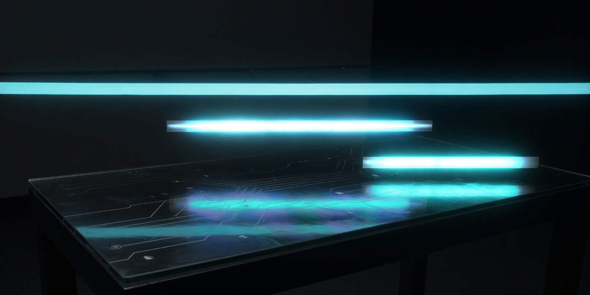

# compaction-drift

Compaction drifts when the kept context drops a fact the full session still has.

One checked-in session is replayed four ways. **no-compaction** keeps every turn. **drop-tools** keeps the user and agent turns and drops tool results. **head-only** keeps the opening and the final question. **summary** keeps that opening, replaces the dropped middle with a checked-in summary, and keeps the question. The final answer is the latest value of each asked fact still on a kept turn. No model is called. A mode matches only when its answer equals the no-compaction answer.

The session is a claim bot ship decision. The opening says model small, limit 500 ZAR, blocking field incident_date. Finance later sets the limit to 2500 ZAR. A second correction switches the model to big. Both corrections are user turns, so dropping the tool results keeps them. The summary records the new limit and leaves the model as it was in the opening. Head-only stops before either correction.

## Run

From the repo root. Python 3.11 or newer. No install and no API key.

```bash
python3 -m compaction_drift fixtures/session.jsonl fixtures/summary.json
python3 -m compaction_drift --verbose fixtures/session.jsonl fixtures/summary.json
python3 -m unittest discover -s tests -v
```

## Score

```
mode           tokens kept  matches  drifted facts     final answer
-------------  -----------  -------  ----------------  -------------------------------------------------------
no-compaction          276  yes      none              model=big limit_zar=2500 blocking_field=incident_date
drop-tools             161  yes      none              model=big limit_zar=2500 blocking_field=incident_date
head-only              120  no       model, limit_zar  model=small limit_zar=500 blocking_field=incident_date
summary                149  no       model             model=small limit_zar=2500 blocking_field=incident_date

Tokens are whitespace-separated words in the text that mode keeps.
```

The full session is 276 words and ships model big at 2500 ZAR. Dropping the tool results leaves 161 words and the same answer. Head-only keeps 120 words and still ships model small at 500 ZAR. The summary keeps 149 words, ships the corrected 2500 ZAR limit, and still says model small.

A fact that is set only on a tool turn does not survive drop-tools. In this session the ship facts are not on tool turns.

## Session shape

`fixtures/session.jsonl` is the session. The first line is the header. `head_turns` is the opening that head-only and summary keep. The last turn is the question and sets no facts. `fixtures/summary.json` is the lossy stand-in for the dropped middle.

```json
{"type":"session","id":"claim-bot","title":"Ship the claim bot","ask":["model","limit_zar","blocking_field"],"head_turns":6}
{"type":"turn","role":"user","text":"Second correction: do not use model small. Claims must use model big. The limit and the blocking field stay as they are.","set":{"model":"big"}}
```

```json
{"text":"Summary of the dropped turns: finance corrected the limit to 2500 ZAR. Claim file reads did not change the blocking field. The model stayed as agreed in the opening.","set":{"limit_zar":"2500"}}
```

## License

MIT
